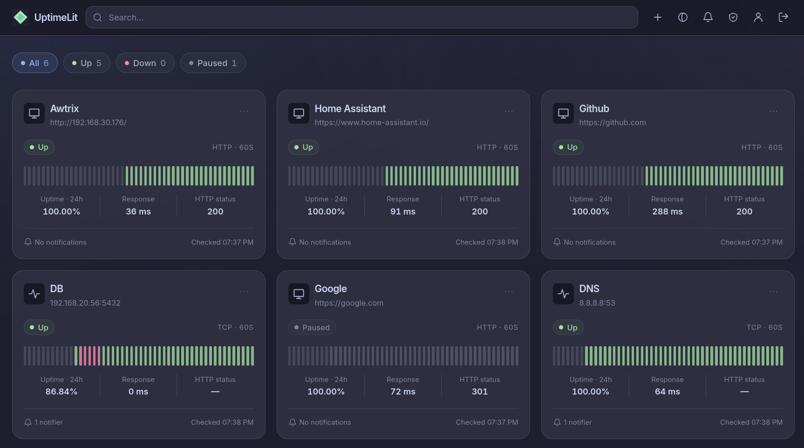
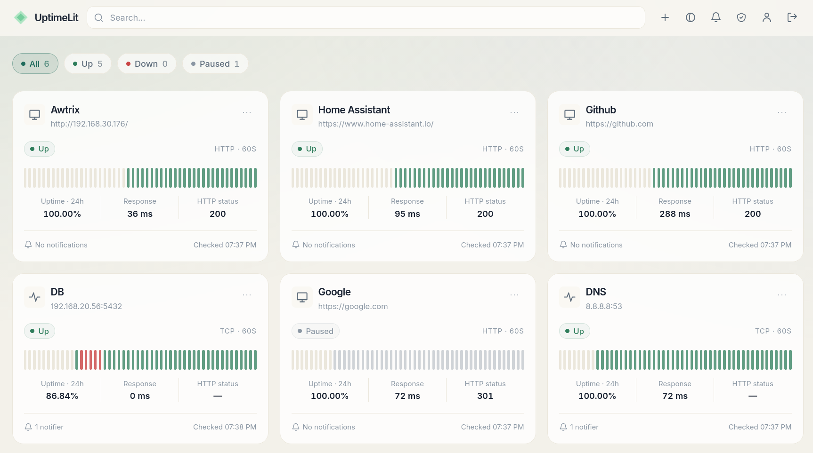

<p align="center">
  
</p>

<h1 align="center">UptimeLit</h1>

<p align="center">A modern, self-hosted uptime monitor for your websites, APIs and TCP services.</p>

<p align="center">
  <a href="https://github.com/codewec/uptimelit/actions/workflows/docker-dev.yml"></a>
  <a href="docs/index.md"></a>
  <a href="backend/go.mod"></a>
  <a href="docs/guide/usage.md#themes"></a>
  <a href="LICENSE"></a>
</p>

> [!TIP]
> **Read the [UptimeLit documentation](docs/index.md)** for installation, configuration, OIDC, monitoring, account management, API usage and backups.

## Screenshots

<p align="center">
  
  
</p>

See the [screenshot gallery](docs/guide/screenshots.md) for full-size previews.

## Highlights

- HTTP/HTTPS and TCP monitoring with configurable intervals and failure thresholds
- Live status, response times, HTTP status codes, recent checks and 24-hour uptime
- One-click **All**, **Up**, **Down** and **Paused** filters; **All** also clears the search
- Compact navbar controls for adding monitors, notifications, themes, administration and profile
- Telegram, Pushover and Redis notifications for outages and recoveries
- Private monitors, history and notifiers for every user, including administrators
- Administrator-managed accounts, password authentication and OIDC; no public registration
- Revocable sessions, profile management and account administration
- Light and dark themes, custom colors and optional background images
- A single Go binary with the Svelte frontend, fonts and styles embedded
- SQLite storage, transactional migrations and 90-day check retention

## Run with Docker

The [build workflow](.github/workflows/docker-dev.yml) publishes `ghcr.io/codewec/uptimelit:dev` on pushes to `main`. The `dev` tag is floating and tracks the latest published development build.

```bash
docker pull ghcr.io/codewec/uptimelit:dev
docker run -d \
  --name uptimelit \
  --restart unless-stopped \
  -p 8080:8080 \
  -v uptimelit-data:/data \
  ghcr.io/codewec/uptimelit:dev
```

Open [http://localhost:8080](http://localhost:8080). On an empty database, the first password sign-in creates the administrator. If OIDC is configured, the first successful OIDC sign-in can create the administrator instead. Additional accounts are created by an administrator.

The container runs as UID/GID `10001:10001`. The database and its WAL files are stored under `/data`.

### Docker Compose

The included [compose.yml](compose.yml) builds from the current checkout:

```bash
git clone https://github.com/codewec/uptimelit.git
cd uptimelit
docker compose up -d --build
```

To use the published image instead, replace `build: .` and `image: uptimelit:local` with `image: ghcr.io/codewec/uptimelit:dev`. See [installation and updates](docs/guide/installation.md) for both deployment modes.

## Configuration

Server settings come from process environment variables. The binary does not load `.env` files itself; Docker Compose passes the authentication settings listed in its service configuration from the shell or a project `.env` file.

| Variable | Default | Description |
| --- | --- | --- |
| `JWT_SECRET` | Generated and saved in SQLite | Optional session signing key, at least 32 bytes |
| `OIDC_ISSUER` | Empty | OIDC provider issuer URL |
| `OIDC_CLIENT_ID` | Empty | OIDC client ID |
| `OIDC_CLIENT_SECRET` | Empty | OIDC client secret |
| `OIDC_REDIRECT_URL` | Empty | Required absolute callback URL when OIDC is enabled |
| `OIDC_BUTTON_TITLE` | `Sign in with OIDC` | Login button label |
| `DISABLE_PASSWORD_LOGIN` | `false` | Disable password login when OIDC is configured |
| `OIDC_INSECURE_SKIP_TLS_VERIFY` | `false` | Explicitly disable certificate verification for OIDC requests |

The runtime settings `UPTIMELIT_ADDR` and `UPTIMELIT_DB` default to `:8080` and `./uptimelit.db`; the Docker image uses `/data/uptimelit.db`. The `-addr` and `-db` flags override their environment values.

For OIDC behind a reverse proxy, use the external callback, for example `https://monitor.example.com/api/auth/oidc/callback`, and forward the original host and protocol. See the [configuration reference](docs/guide/configuration.md), [example environment file](.env.example) and [OIDC guide](docs/guide/oidc.md).

## Development

Requirements: Go 1.27.3+, Node.js 26.13+ and pnpm 12.16.1.

```bash
cd frontend
pnpm install --frozen-lockfile
cd ..
make dev-backend
```

In another terminal:

```bash
make dev-frontend
```

Open `http://localhost:5173`; Vite proxies `/api` to the Go server on port `8080`.

Build the embedded production binary with:

```bash
make build
./app
```

Run checks with `make check` and backend tests with `make test`. Browser tests run with `make test-e2e` after installing Chromium. See the [development guide](docs/guide/development.md) for the project structure, build commands and test setup.

## Data and backups

The `uptimelit-data` volume contains users, monitors, notifiers, check history, sessions and the generated signing key. Stop the container before copying the data volume, or use SQLite's online backup tooling. Preserve your deployment environment settings as well.

`docker compose down` keeps the data volume; `docker compose down -v` deletes it. See [backups and restore](docs/guide/backups.md) for details.

## Acknowledgements

UptimeLit was originally based on [TinyPulse](https://github.com/AkaCoder404/tinypulse) by AkaCoder404. Thanks to its author and contributors for the foundation.

The Svelte frontend's visual system and shared UI foundations are adapted from [DashLit](https://github.com/codewec/dashlit). See [frontend/THIRD_PARTY.md](frontend/THIRD_PARTY.md).

## License

UptimeLit is available under the [MIT License](LICENSE). The original copyright notice is retained. The adapted DashLit components retain their [MIT license](frontend/LICENSE.dashlit).
